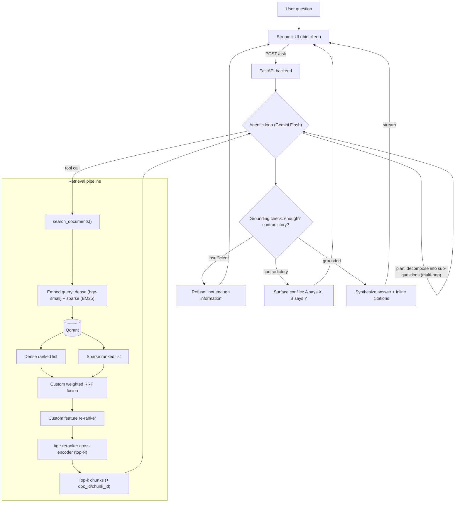
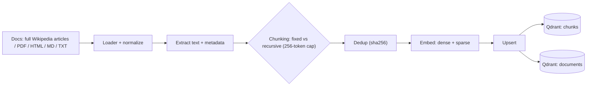
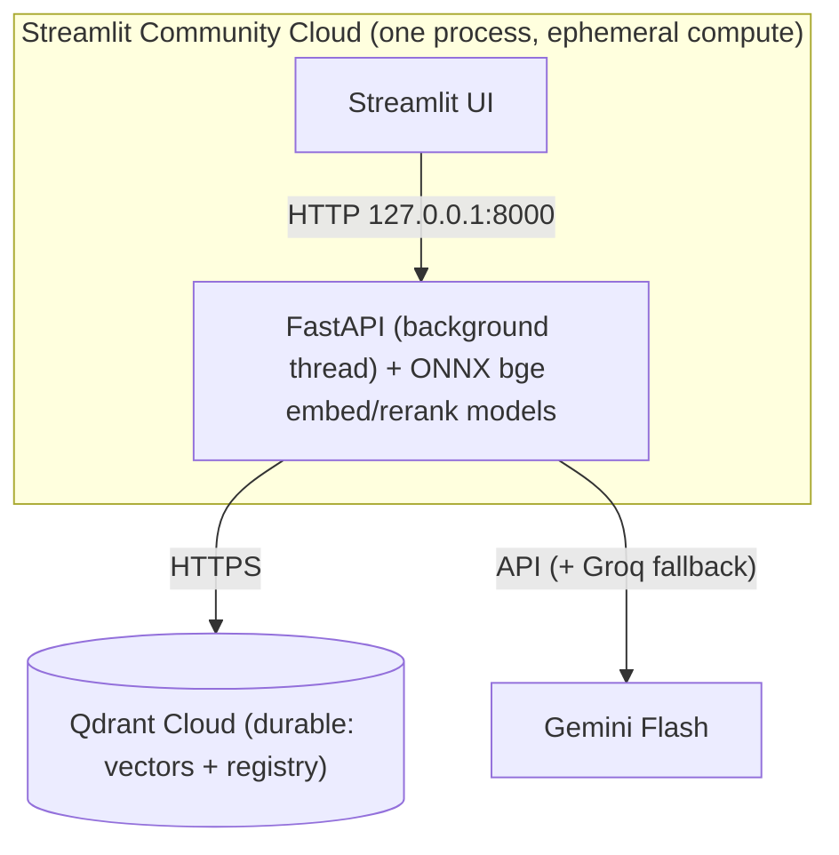

# AI Investigation Engine

An AI system that **investigates large document sets** — not "chat with a PDF." It answers complex
questions that require cross-referencing multiple sources, comparing conflicting information, and drawing
reasoned conclusions, **always with citations**, and **refuses rather than hallucinates** when evidence is
missing or contradictory.

**Live demo:** https://project-x-1.streamlit.app (free tier: the first visit after a quiet spell wakes the
app and loads the models, 1–3 minutes). The 50k-article corpus is read-only there; uploads, updates and
deletes work on your own documents.

> Decisions & rationale: [`GRILL-ME.md`](./docs/GRILL-ME.md). Modules: [`BACKEND.md`](./docs/BACKEND.md) ·
> [`DATABASE.md`](./docs/DATABASE.md) · [`FRONTEND.md`](./docs/FRONTEND.md) · [`EVALUATION.md`](./docs/EVALUATION.md) ·
> [`DATASET.md`](./docs/DATASET.md) · [`SETUP.md`](./docs/SETUP.md). Prep: [`VISUAL-PLAN.md`](./docs/VISUAL-PLAN.md) ·
> [`INTERVIEW-PREP.md`](./docs/INTERVIEW-PREP.md) · [`AI-USAGE.md`](./docs/AI-USAGE.md).

---

## Pipeline map — answering a question



## Pipeline map — ingesting a document



## Deployment / components



### Quick-view (text), in case diagrams don't render

```
Ask:   UI → FastAPI /ask → Agentic loop (Gemini)
                               │  plan → tool call
                               ▼
        search_documents →  [dense + sparse] → Qdrant
                               → custom RRF → custom feature re-ranker
                               → bge-reranker → top-k
                               ▼
        grounding check → refuse | surface conflict | synthesize + cite → stream to UI

Ingest: files(PDF/HTML/MD/TXT) → extract text+meta → chunk(fixed|recursive)
        → dedup(sha256) → embed(dense+sparse) → upsert → Qdrant(chunks + documents)
```

---

## Component overview

| Area | Choice | Doc |
|------|--------|-----|
| Dataset | Full Wikipedia articles (HotpotQA-labeled) → ~50k | [`DATASET.md`](./docs/DATASET.md) |
| Vector DB | Qdrant Cloud (dense + sparse, two collections) | [`DATABASE.md`](./docs/DATABASE.md) |
| Embeddings / rerank | `bge-small-en-v1.5` + `bge-reranker-base` | [`BACKEND.md`](./docs/BACKEND.md) |
| LLM | Gemini 2.x Flash (+ Groq fallback) | [`BACKEND.md`](./docs/BACKEND.md) |
| Retrieval | Hybrid + custom RRF + custom feature re-ranker | [`BACKEND.md`](./docs/BACKEND.md) |
| Reasoning | Agentic tool-calling loop w/ citations + refusal | [`BACKEND.md`](./docs/BACKEND.md) |
| Backend / UI | FastAPI + Streamlit (3 pages) | [`FRONTEND.md`](./docs/FRONTEND.md) |
| Evaluation | 55-Q suite, Recall@K/MRR/Correctness/Citation | [`EVALUATION.md`](./docs/EVALUATION.md) · [Report](./docs/EVALUATION-REPORT.md) |
| Hosting | Streamlit Community Cloud (free; HF Docker Spaces became paid) · Dockerfile for any Docker host | [`SETUP.md`](./docs/SETUP.md) §5 |

---

## Status

Phases 1–4 done: 50k-article corpus on Qdrant Cloud, hybrid retrieval with the custom RRF and feature
re-ranker, the agentic engine with refusal/conflict gates, FastAPI + Streamlit UI, and the evaluation —
see the **[Evaluation Report](./docs/EVALUATION-REPORT.md)** (agentic: 0.87 simple / 0.87 multi-hop answer
accuracy, 0.6 conflict detection, 1.0 injection resistance). Phase 5 done: deployed to Streamlit Community
Cloud (link above) with ONNX models that reproduce the evaluated retrieval (`results/onnx_parity.json`).

## Run it locally

```
python -m venv .venv && .venv\Scripts\Activate.ps1      # macOS/Linux: . .venv/bin/activate
pip install -r requirements-dev.txt
copy .env.example .env                                    # fill in Qdrant, Gemini, Groq keys
uvicorn app.api.main:app --port 8000                      # backend
streamlit run ui/streamlit_app.py                         # UI, second terminal: http://localhost:8501
python -m pytest                                          # tests
```

Building the corpus, the evaluation runs and deployment: [`SETUP.md`](./docs/SETUP.md) and
[`EVALUATION-REPORT.md`](./docs/EVALUATION-REPORT.md) §9.
