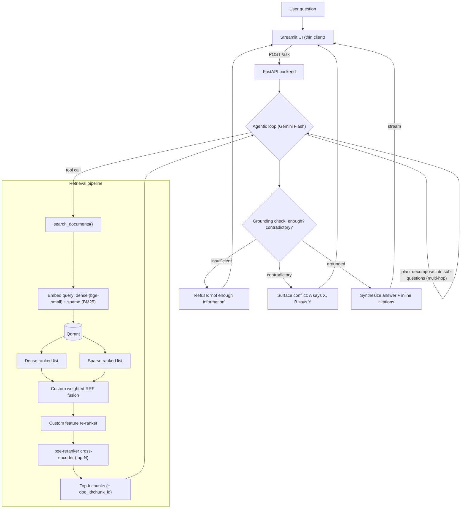
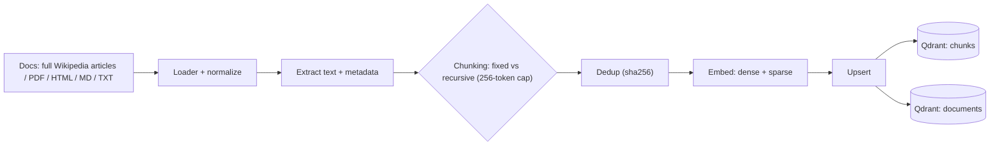
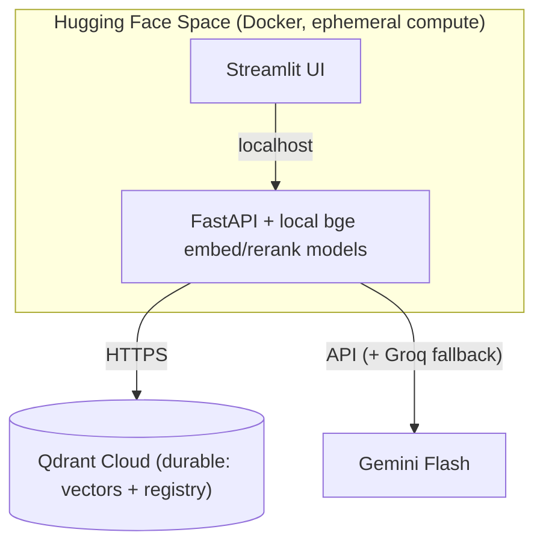

# AI Investigation Engine

An AI system that **investigates large document sets** — not "chat with a PDF." It answers complex
questions that require cross-referencing multiple sources, comparing conflicting information, and drawing
reasoned conclusions, **always with citations**, and **refuses rather than hallucinates** when evidence is
missing or contradictory.

> Decisions & rationale: [`GRILL-ME.md`](./docs/GRILL-ME.md). Modules: [`BACKEND.md`](./docs/BACKEND.md) ·
> [`DATABASE.md`](./docs/DATABASE.md) · [`FRONTEND.md`](./docs/FRONTEND.md) · [`EVALUATION.md`](./docs/EVALUATION.md) ·
> [`DATASET.md`](./docs/DATASET.md) · [`SETUP.md`](./docs/SETUP.md). Prep: [`VISUAL-PLAN.md`](./docs/VISUAL-PLAN.md) ·
> [`INTERVIEW-PREP.md`](./docs/INTERVIEW-PREP.md) · [`AI-USAGE.md`](./docs/AI-USAGE.md).

---

## Pipeline map — answering a question



## Pipeline map — ingesting a document



## Deployment / components



### Quick-view (text), in case diagrams don't render

```
Ask:   UI → FastAPI /ask → Agentic loop (Gemini)
                               │  plan → tool call
                               ▼
        search_documents →  [dense + sparse] → Qdrant
                               → custom RRF → custom feature re-ranker
                               → bge-reranker → top-k
                               ▼
        grounding check → refuse | surface conflict | synthesize + cite → stream to UI

Ingest: files(PDF/HTML/MD/TXT) → extract text+meta → chunk(fixed|recursive)
        → dedup(sha256) → embed(dense+sparse) → upsert → Qdrant(chunks + documents)
```

---

## Component overview

| Area | Choice | Doc |
|------|--------|-----|
| Dataset | Full Wikipedia articles (HotpotQA-labeled) → ~50k | [`DATASET.md`](./docs/DATASET.md) |
| Vector DB | Qdrant Cloud (dense + sparse, two collections) | [`DATABASE.md`](./docs/DATABASE.md) |
| Embeddings / rerank | `bge-small-en-v1.5` + `bge-reranker-base` | [`BACKEND.md`](./docs/BACKEND.md) |
| LLM | Gemini 2.x Flash (+ Groq fallback) | [`BACKEND.md`](./docs/BACKEND.md) |
| Retrieval | Hybrid + custom RRF + custom feature re-ranker | [`BACKEND.md`](./docs/BACKEND.md) |
| Reasoning | Agentic tool-calling loop w/ citations + refusal | [`BACKEND.md`](./docs/BACKEND.md) |
| Backend / UI | FastAPI + Streamlit (3 pages) | [`FRONTEND.md`](./docs/FRONTEND.md) |
| Evaluation | 50-Q suite, Recall@K/MRR/Correctness/Citation | [`EVALUATION.md`](./docs/EVALUATION.md) |
| Hosting | Hugging Face Spaces (Docker) | [`GRILL-ME.md`](./docs/GRILL-ME.md) (D4/A4) |

---

## Status

Spec/design complete and **design-review-hardened** — 24 decisions locked ([`GRILL-ME.md`](./docs/GRILL-ME.md)),
`SETUP.md` added. Implementation pending (Phase 1: **offline corpus ingestion**). Deliverables still to
produce: Evaluation Report (post-run) and the live demo URL.
