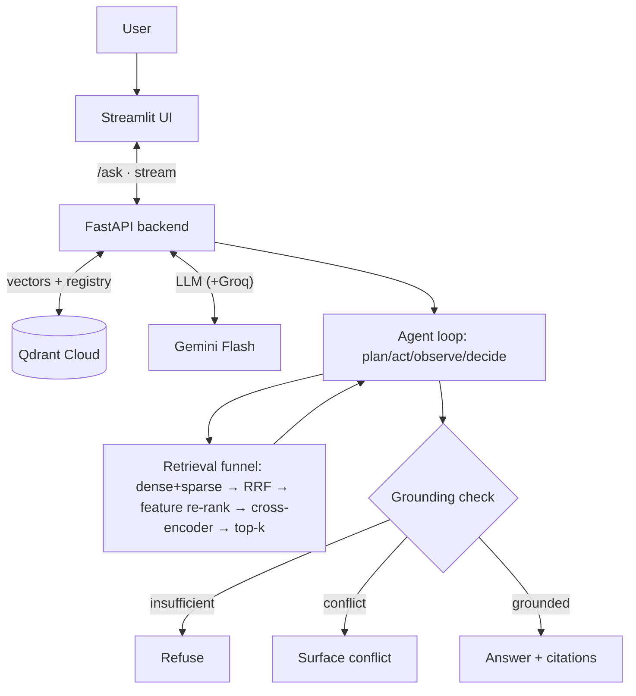

# VISUAL PLAN — Whiteboard Map

> A diagram you can **redraw on a board from memory** and **narrate live**. Three layers: the big picture,
> the retrieval funnel, and ingestion. Draw them in the numbered order; the narration under each step is
> roughly what you'd say out loud. Mermaid mirrors at the bottom for on-screen viewing.

---

## Layer 1 — The big picture (draw this first)

```
            ┌──────────────────────────────────────────────────────────────┐
            │              HUGGING FACE SPACE  (Docker, stateless)           │
            │                                                                │
  ┌──────┐  │  ┌────────────┐          ┌──────────────────────────────┐     │
  │ USER │──┼─▶│ STREAMLIT  │  /ask    │        FASTAPI BACKEND        │     │
  │      │◀─┼──│    UI      │◀────────▶│   (RAG engine + bge models)   │     │
  └──────┘  │  └────────────┘  stream  └───────────────┬──────────────┘     │
            │                                   │        │                    │
            └───────────────────────────────────┼────────┼────────────────────┘
                                                 │        │
                               vectors + registry│        │ LLM calls
                                                 ▼        ▼
                                        ┌──────────────┐  ┌───────────────┐
                                        │ QDRANT CLOUD │  │ GEMINI  Flash │
                                        │  (durable)   │  │ (+Groq backup)│
                                        │ chunks + docs│  └───────────────┘
                                        └──────────────┘
```

**Draw & narrate:**
1. Box **USER** on the left. *"A user asks a complex question."*
2. Big box **HUGGING FACE SPACE** around the middle — *"everything runs here, but it's stateless compute."*
3. Inside it: **STREAMLIT UI** and **FASTAPI BACKEND**; arrow UI→backend labelled `/ask`, arrow back labelled `stream`. *"UI is a thin client; all logic is in the backend, which the eval also calls."*
4. Below, outside the Space: **QDRANT CLOUD** (`chunks + docs`). Arrow backend→Qdrant. *"Durable data lives outside the Space so a restart loses nothing."*
5. Next to it: **GEMINI Flash (+Groq backup)**. Arrow backend→LLM. *"LLM is external and abstracted, with a fallback for rate limits."*

That's the whole system in 5 boxes. Everything else is *inside* the backend box ↓

---

## Layer 2 — Inside the backend: the RAG loop (draw second)

```
        question in
            │
            ▼
   ┌─────────────────┐   tool call: search_documents()
   │   AGENT  LOOP   │──────────────────────────────┐
   │  (Gemini Flash) │                               ▼
   │ plan ▸ act ▸    │                      ┌───────────────────┐
   │ observe ▸ decide│◀─────────────────────│ RETRIEVAL FUNNEL  │  (Layer 3)
   └────────┬────────┘   top-k chunks        └───────────────────┘
            │   (loop ≤ N times: cap + budget)
            ▼
     ◇ GROUNDING CHECK ◇   enough? contradictory?
       ├── not enough ──────▶ REFUSE  ("no info")
       ├── conflict ───────▶ SURFACE CONFLICT  (A vs B)
       └── grounded ───────▶ ANSWER + CITATIONS ──▶ (stream to UI)
```

**Draw & narrate:**
1. **AGENT LOOP** box — *"The LLM plans sub-questions and decides when to search — that's the multi-hop investigation."*
2. Arrow out to the **RETRIEVAL FUNNEL**, arrow back with **top-k chunks**; note *"loop is capped by max iterations + a tool budget so it can't run away."*
3. A **diamond = GROUNDING CHECK** with three exits: **refuse**, **surface conflict**, **answer + citations**. *"This is the anti-hallucination gate — it refuses or flags conflicts instead of guessing."*

---

## Layer 3 — The retrieval funnel (draw third — your custom work lives here)

Draw it as a **funnel: wide at top, narrow at bottom.** Many candidates in, few out.

```
     query ─▶ ┌───────────────────────────────────────────────┐
              │  DENSE (bge-small, cosine)  +  SPARSE (BM25)    │  ← 2 lists from Qdrant
              └───────────────────────┬───────────────────────┘
                                      ▼
              ┌───────────────────────────────────────────────┐
              │  (1) CUSTOM WEIGHTED RRF  — fuse by rank        │  ★ my component #1
              └───────────────────────┬───────────────────────┘
                                      ▼
              ┌───────────────────────────────────────────────┐
              │  (2) CUSTOM FEATURE RE-RANKER                   │  ★ my component #2
              │  (title + entity + phrase + answer-type)        │
              └───────────────────────┬───────────────────────┘
                                      ▼
              ┌───────────────────────────────────────────────┐
              │  (3) bge-reranker cross-encoder (top-N only)    │  (bonus)
              └───────────────────────┬───────────────────────┘
                                      ▼
                             TOP-K chunks (+ doc_id)
```

**Draw & narrate:**
1. Top: **DENSE + SPARSE** → *"hybrid search: meaning + exact keywords, both from Qdrant."*
2. **(1) RRF** → *"my custom fusion — combines the two lists by rank, not raw score, because the scales differ."* (mark with a ★ — "this is my required custom component.")
3. **(2) Feature re-ranker** → *"my second custom stage — cheap, explainable, scores title match, entity and exact-phrase overlap, and answer type. No recency or authority: the corpus is undated, single-source Wikipedia, and recency would even promote the planted contradictions."*
4. **(3) bge-reranker** → *"off-the-shelf precision pass on the short list — the bonus."*
5. Out the bottom: **top-k chunks** back to the agent.

> The two ★ boxes are the single most important thing to be able to defend — the task bans a
> 100%-off-the-shelf stack, and these are what you built.

---

## Side sketch — Ingestion (how documents get in)

```
 files              ┌────────┐   ┌─────────┐   ┌──────────────┐   ┌──────┐   ┌────────┐
 PDF/HTML   ──────▶ │ extract│──▶│  chunk  │──▶│ dedup sha256 │──▶│ embed│──▶│ upsert │──▶ QDRANT
 MD/TXT             │ text+  │   │ fixed   │   │              │   │dense │   │        │   (chunks
                    │ meta   │   │  vs     │   │              │   │+     │   │        │    + docs)
                    └────────┘   │recursive│   └──────────────┘   │sparse│   └────────┘
                                 └─────────┘                      └──────┘
```

*"Three+ formats → extract text + metadata → chunk (the A/B I compare) → dedup by hash → embed dense+sparse
→ upsert into Qdrant's two collections."*

---

## One-line story (say this if asked for the 30-second version)

> *"A thin Streamlit UI calls a FastAPI backend where a Gemini agent investigates: it plans sub-questions,
> calls a retrieval tool that does hybrid search (dense + sparse) fused by my custom RRF, re-ranked by my
> feature re-ranker and a cross-encoder, then a grounding check makes it cite sources — or refuse — before
> streaming the answer. Documents live in Qdrant Cloud so the free host can restart without losing data."*

---

## Mermaid mirrors (for the screen)


